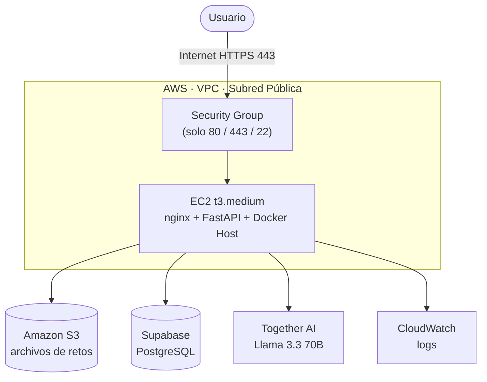

# WISPR — Arquitectura MVP (la que realmente se despliega)

Esta es la arquitectura de infraestructura que se usa durante el desarrollo del proyecto y para la
demostración en EXPOTEC. Es una versión simplificada de [arquitectura_produccion.md](arquitectura_produccion.md),
pensada para el nivel del equipo, el tiempo disponible y el presupuesto real.

> **¿Vas a desplegar el backend?** Los pasos concretos están en la sección **CONFIG AWS**, al final
> de este documento.

---

## Diagrama de infraestructura



Todo corre en **una sola instancia EC2**: el servidor web (nginx + FastAPI) y el host de Docker
para los contenedores de retos conviven en la misma máquina. No hay subredes privadas ni NAT Gateway —
el Security Group es el único firewall, permitiendo solo los puertos necesarios.

---

## Diagrama de red (versión texto — para recrear en Canva)

```
                     ┌───────────────────────────────┐
                     │   USUARIO (App Electron)       │
                     │   React + xterm.js              │
                     └────────────────┬────────────────┘
                                       │
                                       │  HTTPS / WSS — puerto 443
                                       │  (login, API, webshell)
                                       ▼
                          ┌─────────────────────────┐
                          │    Internet Gateway      │
                          └────────────┬─────────────┘
                                       │
   ┌───────────────────────────────────▼────────────────────────────────────┐
   │  AWS · VPC · Subred Pública                                            │
   │                                                                        │
   │   ┌──────────────────────────────────────────────────────────────┐    │
   │   │  Security Group                                                │    │
   │   │  Entrada: 443 (HTTPS/WSS) · 80 (HTTP→HTTPS) · 22 (SSH, solo    │    │
   │   │  IP del administrador)                                         │    │
   │   └────────────────────────────┬─────────────────────────────────┘    │
   │                                 ▼                                      │
   │   ┌──────────────────────────────────────────────────────────────┐    │
   │   │  EC2 t3.medium — 2 vCPU · 4 GB RAM · Red: hasta 5 Gbps        │    │
   │   │                                                                │    │
   │   │   nginx (proxy)  →  FastAPI + Uvicorn  →  Docker Host          │    │
   │   │                                            (retos CTF)         │    │
   │   └────────────────────────────┬─────────────────────────────────┘    │
   └────────────────────────────────┼───────────────────────────────────────┘
                                     │
                                     ▼
                (El backend, desde dentro de la instancia, se conecta a:)

        Amazon S3            ◄──  HTTPS 443        ──  archivos de retos
        Supabase PostgreSQL  ◄──  TCP 5432 / 6543   ──  usuarios, flags, puntajes
        Together AI          ◄──  HTTPS 443        ──  recomendaciones (Llama 3.3 70B)
        AWS CloudWatch       ◄──  HTTPS 443        ──  logs del sistema
```

---

## Requerimientos de red por componente

### Lado del usuario (cliente / App Electron)

| Acción del usuario | Qué viaja por la red | Tamaño aproximado | Qué importa más |
|---|---|---|---|
| Login | Envía credenciales, recibe JWT | ~1-2 KB | Casi nada — funciona incluso con conexión lenta |
| Navegar dashboard / catálogo de retos | Peticiones REST en JSON | Unos KB por pantalla | Bajo — cualquier banda ancha básica alcanza |
| Descargar archivos de un reto | Descarga directa desde S3 (URL firmada) | 1-50 MB según el reto (ej. un `.pcap`) | Ancho de banda — con 2-5 Mbps de bajada se descarga en segundos |
| Usar la webshell (terminal) | WebSocket persistente, texto en tiempo real | Bytes por tecla/respuesta | **Latencia**, no ancho de banda — necesita baja latencia (< 150 ms ideal) para sentirse fluida, como una sesión SSH |

**En resumen:** con una conexión de banda ancha normal (mínimo ~2 Mbps de bajada / 1 Mbps de
subida) la plataforma funciona sin problema. Lo único realmente sensible es la latencia de la
webshell, no el ancho de banda — por eso conviene desplegar el EC2 en la región de AWS más
cercana geográficamente a donde se hará la demo (ej. `us-east-1` si EXPOTEC es en Costa Rica).

> **Nota de diseño importante:** los archivos de retos se descargan **directo desde S3 al
> usuario** mediante una URL firmada (presigned URL), no a través del EC2. Esto es clave: así el
> EC2 nunca carga con el peso de transferir archivos grandes, y su capacidad de red casi no
> importa para ese caso — solo importa para las peticiones API y la webshell, que son livianas.

### Lado de AWS (especificaciones por servicio)

| Componente | Especificación de red | Notas |
|---|---|---|
| EC2 t3.medium | Hasta 5 Gbps de red (ráfaga, compartida) | Muy por encima de lo necesario — con 10-20 usuarios simultáneos en EXPOTEC, el uso real es una fracción mínima de esa capacidad |
| Security Group | Entrada: 443 (HTTPS/WSS), 80 (redirección), 22 (SSH solo IP admin) | Un solo puerto público real de cara al usuario (443) — la webshell viaja por el mismo WSS, no necesita puerto aparte |
| Amazon S3 | Sin límite de instancia (servicio administrado); miles de solicitudes/segundo soportadas | El cliente descarga directo con URL firmada (ver nota arriba) |
| Supabase (externo a AWS) | Puerto 5432 (conexión directa) o 6543 (pooler) | Tráfico saliente del EC2 hacia internet; recomendado usar el pooler (6543) si hay muchas conexiones concurrentes |
| Together AI (externo) | HTTPS 443 | Peticiones pequeñas (prompt + respuesta, unos KB); respuesta típica en 1-5 segundos |
| AWS CloudWatch | HTTPS 443 saliente | Volumen mínimo — solo texto de logs |

**Mejora opcional gratuita:** se puede agregar un *S3 Gateway Endpoint* (sin costo, no requiere
NAT Gateway ni subred privada) para que el tráfico entre el EC2 y S3 viaje dentro de la red de
AWS en vez de por internet público. No es necesario para el MVP, pero es una mejora de
seguridad fácil de agregar después sin rediseñar nada.

---

## Por qué esta versión y no la de 3 subredes

| Arquitectura de producción (Gemini) | Arquitectura MVP (esta) |
|---|---|
| 3 instancias EC2 (Web, IA, Sandbox) | 1 instancia EC2 |
| 3 subredes (pública + 2 privadas) | 1 subred pública |
| NAT Gateway | Sin NAT Gateway |
| NACLs + Security Groups en cadena | Un Security Group |
| ~$122 USD/mes corriendo 24/7 | ~$30-40 USD/mes corriendo 24/7, mucho menos si se pausa |

La versión de producción no está mal — es correcta y demuestra buen entendimiento de Defensa en
Profundidad. El problema es que resuelve un problema de escala (miles de usuarios concurrentes,
adversarios reales) que WISPR no tiene todavía. Para el MVP, el aislamiento de los retos lo dan
Docker mismo (namespaces, seccomp, AppArmor) — que ya eran parte del plan original — no la
segmentación de red.

---

## Cómo pausar el gasto: encender solo cuando se trabaja

La instancia EC2 se factura **por hora mientras está corriendo**. Si se detiene (Stop, no Terminate)
al terminar la sesión de trabajo, el cómputo deja de cobrarse — solo queda el costo mínimo del disco
(EBS), unos ~$2.40 USD/mes por 30 GB.

**Flujo recomendado:**
1. Antes de trabajar: iniciar la instancia (`aws ec2 start-instances` o desde la consola).
2. Trabajar normalmente.
3. Al terminar: detenerla (`aws ec2 stop-instances`).

**Costo estimado real** (14 semanas de julio a octubre, ~3h/día, 4 días/semana ≈ 168 horas de
cómputo): **~$17 USD en total**, muy por debajo del presupuesto de $300-400.

**Detalles a tener en cuenta:**
- Al reiniciar la instancia, la IP pública cambia (a menos que se pague ~$3.60/mes por una
  Elastic IP fija). Para desarrollo esto es solo actualizar la URL del backend en el `.env` del
  frontend cada vez — no vale la pena pagar por IP fija todavía.
- S3, Supabase y Together AI ya cobran por uso, no por tiempo activo — no hace falta "pausarlos".
- Recomendado: configurar una regla de auto-apagado (EventBridge + Lambda, o una alarma de
  facturación) como red de seguridad, para no dejar la instancia prendida por accidente un fin
  de semana entero.

---

## Componentes y costo estimado

| Componente | Rol | Costo aproximado |
|---|---|---|
| EC2 t3.medium | nginx + FastAPI + Docker host de retos | ~$0.0416/hora solo mientras corre |
| Amazon S3 | Archivos de retos (.pcap, binarios, imágenes) | Casi $0 al volumen del proyecto |
| Supabase | Base de datos PostgreSQL | $0 (tier gratuito) |
| Together AI | Llama 3.3 70B vía API, sin fine-tuning | Pago por token, estimado < $5/mes |
| CloudWatch | Logs básicos del backend | $0 (dentro del tier gratuito) |
| EBS (disco del EC2) | Persistencia mientras la instancia está detenida | ~$2.40/mes |

---

## Nota sobre el sandbox de retos (Docker)

Se confirmó que el Docker Host es **centralizado en AWS**, compartido por todos los usuarios —
consistente con la promesa original de WISPR ("sin necesidad de configurar máquinas virtuales
externas"). Esto implica que hay que limitar los recursos que cada contenedor de reto puede
consumir (memoria y CPU) para que un usuario no afecte a los demás en la misma instancia. Se
implementa con los límites nativos de Docker (`--memory`, `--cpus`) al lanzar cada contenedor de
reto, no con hardware separado.

Si en pruebas con varios usuarios simultáneos el `t3.medium` se queda corto de memoria, subir a
un `t3.large` es un cambio de una sola línea en la configuración de AWS, sin rediseñar nada.

---

# CONFIG AWS

Lista de pasos concretos para que el backend (FastAPI) funcione en la instancia EC2. Revisado contra
el código real el 11 oct 2026. Los marcados 🔴 hacen que el backend **no arranque o no funcione**
si se omiten; los 🟡 son de **seguridad** y son obligatorios antes de abrirlo al público.

### 🔴 1. `DATABASE_URL`: usar el *Session pooler* de Supabase, no la conexión directa

La conexión directa (`db.<ref>.supabase.co:5432`) **solo tiene dirección IPv6** (verificado: no
resuelve a IPv4). Una EC2 en la VPC por defecto solo habla IPv4, así que el backend no podría
conectarse a la base de datos.

- En supabase.com → proyecto → **Connect** → **Session pooler** → copiar esa URL.
- Tiene la forma `postgresql://postgres.<ref>:<contraseña>@aws-0-<región>.pooler.supabase.com:5432/postgres`.
- Usar el **Session** pooler (puerto 5432), no el *Transaction* pooler (6543): este último no es
  compatible con cómo SQLAlchemy y Alembic manejan las conexiones por defecto.
- Ponerla en el `.env` del servidor. Es solo configuración: no hay que tocar código.

### 🔴 2. `uvicorn` con **un solo worker**

Los códigos MFA pendientes viven en la memoria del proceso (`app/services/auth_flow.py`). Con
varios workers, un código creado en un proceso no existe en los otros y la verificación falla al
azar. Correr:

```bash
uvicorn main:app --host 127.0.0.1 --port 8000 --workers 1
```

(`127.0.0.1`: solo nginx habla con uvicorn; el puerto 8000 no se abre en el Security Group.)
Un solo worker sobra para EXPOTEC y para un aula. Si algún día hace falta más de uno, primero hay
que mover los códigos pendientes a una tabla en la BD.

### 🔴 3. Migraciones y catálogo de retos

Después de configurar el `.env`, desde `backend/`:

```bash
alembic -c migrations/alembic.ini upgrade head
python -m app.db.seed_challenges   # carga el catálogo de retos y genera sus archivos
```

El seed se puede correr las veces que haga falta (actualiza, no duplica). Hay que volver a
correrlo si cambia `challenges/catalog/catalog.json`.

### 🟡 4. `ENVIRONMENT=production` en el `.env`

Con este valor, si el correo no se puede enviar, el registro/login **falla** en vez de caer al
"modo desarrollo" (que devuelve el código MFA en la respuesta y lo escribe en el log, anulando el
MFA). Implementado en `app/services/email.py::_fallback` y probado en `tests/unit/test_email.py`.

### 🟡 5. HTTPS con nginx

Los tokens de sesión viajan en la cabecera `Authorization`: sin HTTPS se pueden robar. nginx
termina TLS (certificado de Let's Encrypt con `certbot`, requiere un dominio apuntando a la IP
elástica) y reenvía a `127.0.0.1:8000`. El WebSocket de la terminal, cuando exista, va por `wss://`.

### 🟡 6. Restringir CORS

`main.py` hoy acepta cualquier origen (`allow_origins=["*"]`). En producción, cambiarlo al dominio
real del frontend.

### ✅ Ya compatible (no requiere nada)

- **SO recomendado:** Ubuntu 24.04 LTS (trae Python 3.12). Todas las dependencias de
  `requirements.txt` tienen versión precompilada para Linux.
- **Correo:** Gmail por el puerto 587 funciona desde EC2 (AWS solo restringe el puerto 25).
- **Archivos de retos generados:** se guardan en `challenges/generated/` local — válido con una sola
  instancia. Pasar a S3 es un paso posterior (punto 9 del plan en `CLAUDE.md`).
- **Node.js:** el backend no lo necesita. Solo lo usan el frontend prototipo y la terminal Kali.
  Los archivos de los retos Wi-Fi (`challenges/static/`) ya vienen generados en el repositorio.
- **Supabase pausado:** si la base de datos da `could not translate host name`, reactivar el
  proyecto en supabase.com antes de asumir que algo del servidor está mal.
