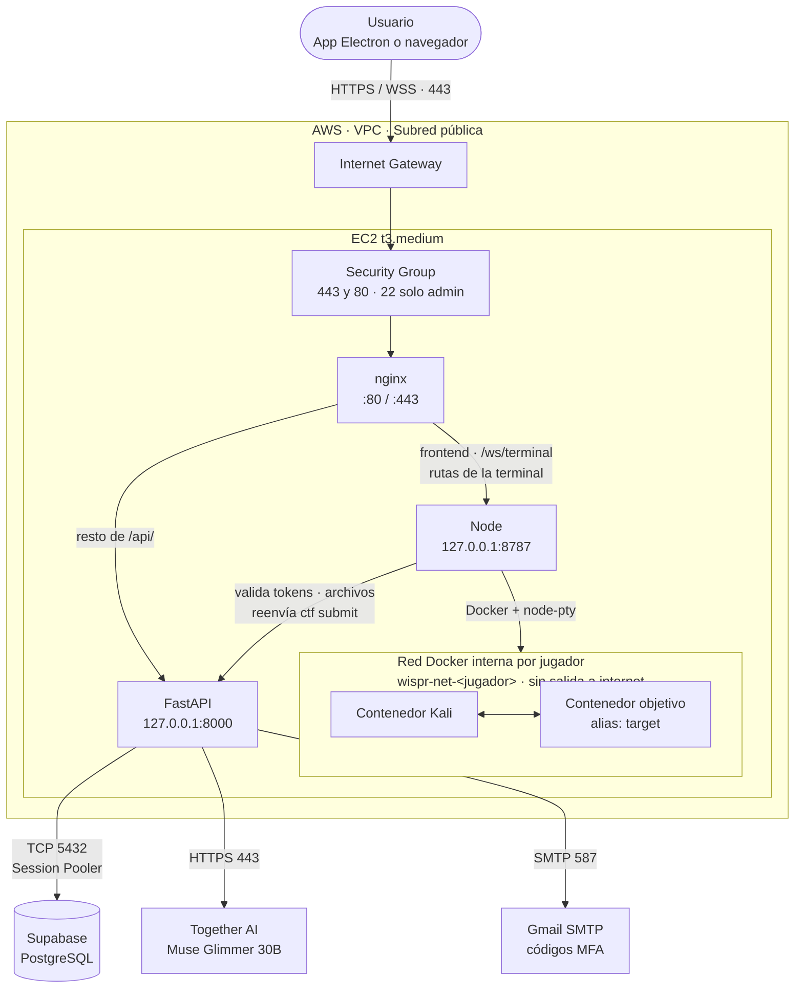

# WISPR — Diagrama de red real

Describe la red que corresponde al código actual (31 oct 2026): `deploy/nginx/wispr.conf`,
`WISPR-frontend/server.js` y el backend FastAPI. Muestra cómo debe quedar la instancia en AWS.
Este documento no confirma que el despliegue ya esté hecho.

Si no coincide con `arquitectura_mvp.md`, vale este. Las diferencias están en
[la última sección](#diferencias-con-arquitectura_mvpmd).

## Diagrama



## Versión en texto

```text
 Usuario (app Electron o navegador)
              │  HTTPS / WSS, puerto 443
              ▼
      Internet Gateway
              │
┌─────────────▼───────────────────────────────────────────┐
│ AWS · VPC · subred pública                              │
│  Security Group: 443 y 80 abiertos · 22 solo admin      │
│  ┌───────────────────────────────────────────────────┐  │
│  │ EC2 t3.medium                                     │  │
│  │              nginx (:80 / :443)                   │  │
│  │              │               │                    │  │
│  │     resto de /api/    frontend, terminal,         │  │
│  │              │        /api/kali/*                 │  │
│  │              ▼               ▼                    │  │
│  │    FastAPI :8000 ◄──── Node :8787                 │  │
│  │              │   valida   │                       │  │
│  │              │   tokens   ▼ Docker + node-pty     │  │
│  │              │      ┌─────────────────────┐       │  │
│  │              │      │ wispr-net-<jugador> │       │  │
│  │              │      │ red interna         │       │  │
│  │              │      │ Kali ◄──► objetivo  │       │  │
│  │              │      └─────────────────────┘       │  │
│  └──────────────┼────────────────────────────────────┘  │
└─────────────────┼───────────────────────────────────────┘
                  ▼ salidas de FastAPI
   Supabase PostgreSQL · TCP 5432 (Session Pooler)
   Together AI         · HTTPS 443
   Gmail SMTP          · puerto 587
```

## Componentes

| Componente | Dirección | Función |
|---|---|---|
| Electron o navegador | Equipo del usuario | Muestra WISPR y abre la terminal con xterm.js |
| Security Group | Borde de la instancia | Único firewall: 443 y 80 abiertos, 22 solo para la IP del administrador |
| nginx | `:80`, `:443` | Único punto de entrada; reparte el tráfico por ruta |
| FastAPI | `127.0.0.1:8000` | Cuentas, sesiones, retos, flags, ranking, grupos y progreso |
| Node | `127.0.0.1:8787` | Sirve el frontend y controla la terminal y los contenedores |
| Kali | Red interna de Docker | Terminal del jugador |
| Objetivo (`target`) | Red interna de Docker | Servicio simulado de ciertos retos |

## Reparto de rutas en nginx

| Ruta | Destino |
|---|---|
| `/ws/terminal` | Node (WebSocket) |
| `/api/kali/*` | Node |
| `/api/challenges/active` | Node |
| `/api/platform/status` | Node |
| Resto de `/api/` | FastAPI |
| `/` | Node (frontend) |

## Conexiones

| Origen | Destino | Protocolo y puerto | Para qué |
|---|---|---|---|
| Usuario | nginx | HTTPS/WSS 443 | Página, API y terminal |
| Usuario | nginx | HTTP 80 | Redirección a HTTPS (se activa al configurar `certbot`) |
| Administrador | EC2 | SSH 22 | Administración, solo desde su IP |
| nginx | FastAPI | HTTP local 8000 | API |
| nginx | Node | HTTP/WebSocket local 8787 | Frontend y terminal |
| Node | FastAPI | HTTP local 8000 | Validar tokens, bajar catálogo y archivos, enviar flags y pistas |
| Node | Docker | Local | Crear, iniciar y detener contenedores |
| FastAPI | Supabase | TCP 5432 | Base de datos, por el Session Pooler |
| FastAPI | Together AI | HTTPS 443 | Historias de los retos |
| FastAPI | Gmail | SMTP 587 | Códigos MFA |

## Aislamiento de los contenedores

- Cada jugador tiene su propia red `wispr-net-<jugador>`, creada con `--internal`: los contenedores
  no tienen salida a internet.
- Ningún contenedor publica puertos hacia afuera. El usuario llega a Kali solo por `/ws/terminal`.
- Kali y el objetivo corren sin capacidades de Linux (`--cap-drop ALL`), con
  `no-new-privileges`, sistema de archivos de solo lectura, usuario sin privilegios y límite de
  procesos.

| Contenedor | Memoria | CPU | Procesos |
|---|---|---|---|
| Kali | 2 GB por defecto; 768 MB en la EC2 (`KALI_MEMORY`) | 2 (`KALI_CPUS`) | 256 |
| Objetivo | 128 MB | 0.5 | 64 |

## Seguridad de la sesión

- FastAPI es la única fuente de verdad de las sesiones. Node valida cada token con
  `GET /api/players/me`; si FastAPI no responde, niega el acceso.
- Una terminal abierta se cierra si la sesión deja de ser válida (revisión cada 60 s).
- Las sesiones usan un token opaco revocable guardado como hash en Supabase. No son JWT.

## Diferencias con `arquitectura_mvp.md`

| El documento dice | Lo que hay en el código |
|---|---|
| nginx → FastAPI → Docker | Node maneja Docker; FastAPI no lo toca |
| No aparece Node | Node sirve el frontend y la terminal |
| Archivos de retos en S3 con descarga directa | S3 no está integrado: FastAPI sirve los archivos desde el disco de la EC2 |
| CloudWatch recibe los logs | Sin configurar |
| El login devuelve un JWT | Token opaco de sesión guardado en Supabase |
| Supabase por 5432 o 6543 | Configurado por el Session Pooler, puerto 5432 |
| No aparece el correo | FastAPI manda los códigos MFA por Gmail SMTP |

## Pendiente para que la red quede así

- **HTTPS:** `wispr.conf` solo escucha en el puerto 80. El 443 se agrega con `certbot` al desplegar.
- **Dominio:** cambiar `server_name` y poner la misma dirección en `WISPR_PUBLIC_HOSTS` de Node.
